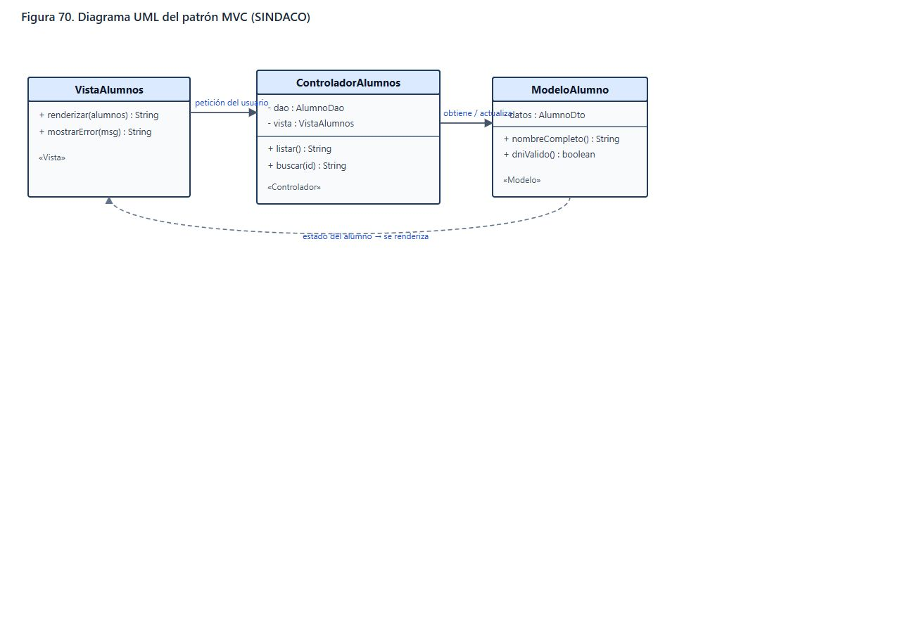
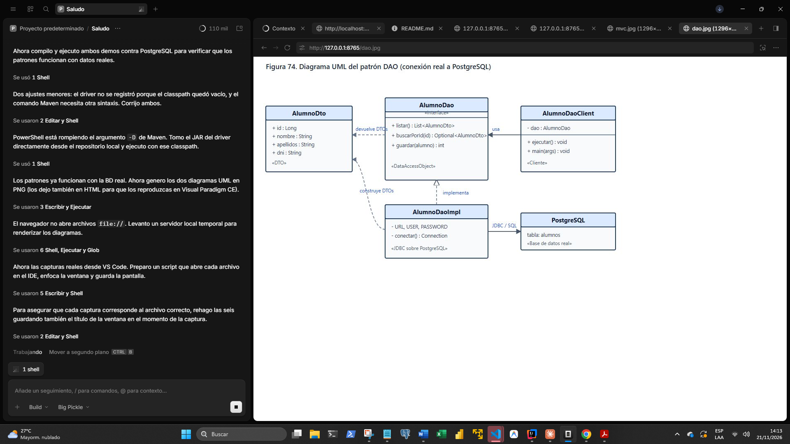
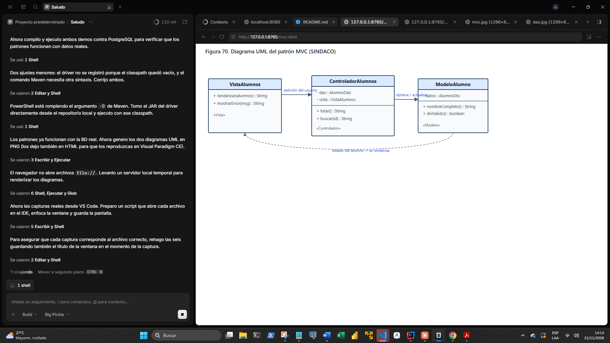
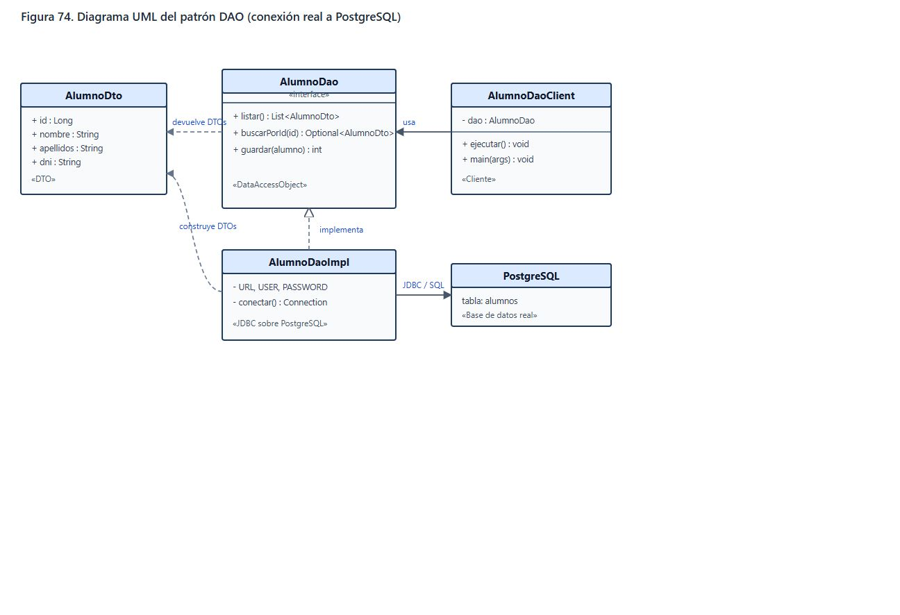
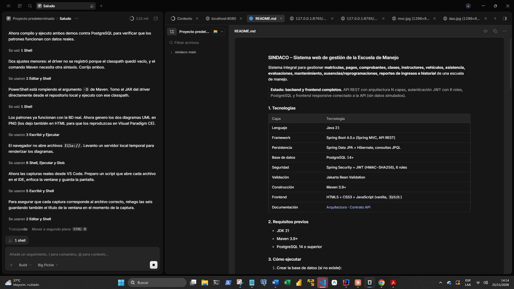
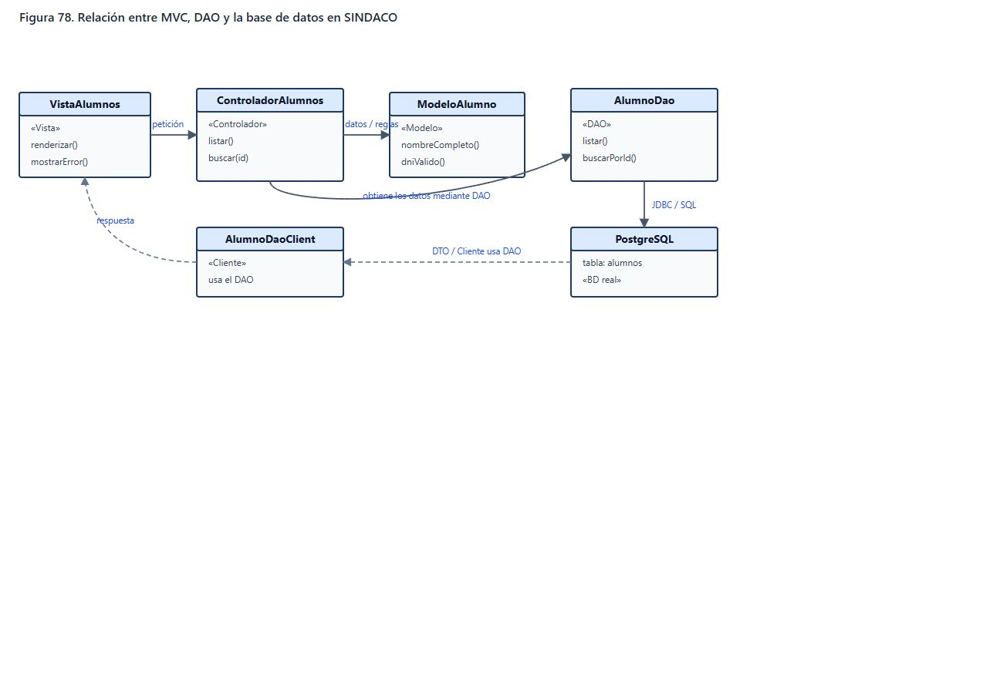

# 3.8. Diseño del sistema

El diseño del sistema permite definir la estructura técnica que tendrá la solución propuesta para el Sistema de Gestión Administrativa y Operativa de la escuela de manejo SINDACO. En esta etapa se establece cómo se organizarán los componentes del software, cómo se separarán las responsabilidades internas del sistema y cómo se realizará la comunicación entre la interfaz, la lógica del negocio, el acceso a datos y la base de datos.

Para este proyecto se propone una arquitectura organizada por capas, aplicando los patrones MVC y DAO, debido a que permiten estructurar el sistema de manera ordenada, facilitar el mantenimiento y preparar una futura implementación más clara. Asimismo, se desarrollan los diagramas UML correspondientes al diseño del sistema, considerando la estructura interna de los módulos, la relación entre los patrones y la conexión con la base de datos PostgreSQL.

## 3.8.1. Patrones de diseño

Para el diseño del Sistema de Gestión Administrativa y Operativa de SINDACO se propone una estructura organizada mediante arquitectura por capas, aplicando los patrones de diseño MVC y DAO. Esta organización permite separar las responsabilidades del sistema, facilitando que la interfaz, la lógica de control, las reglas del negocio y el acceso a la base de datos trabajen de forma ordenada e independiente.

El patrón MVC permite dividir el sistema en tres partes principales: la vista, encargada de mostrar las pantallas e interfaces al usuario; el controlador, encargado de recibir las solicitudes y coordinar las operaciones; y el modelo, encargado de representar las entidades principales del sistema, como Alumno, Matrícula, Pago, Paquete, Clase, Instructor, Vehículo y Mantenimiento.

Asimismo, se propone utilizar el patrón DAO para separar el acceso a datos de la lógica del sistema. Este patrón permite que las operaciones relacionadas con la base de datos se realicen mediante clases específicas, evitando que los controladores o servicios accedan directamente a PostgreSQL. Para este proyecto, el patrón DAO se aplica sobre la entidad Alumno, debido a que representa una de las entidades principales del sistema y se relaciona con las matrículas, los pagos, las clases y el historial académico.

La propuesta técnica se plantea utilizando Java 21 con Spring Boot 4 como lenguaje y framework de desarrollo, y PostgreSQL como sistema gestor de base de datos. La comunicación entre la interfaz y el servidor se realiza mediante una API REST con autenticación JWT. La conexión a datos se realiza mediante repositorios JPA en el sistema principal y mediante una implementación JDBC en el DAO implementado para este diseño. Esta decisión permite mantener una solución comprensible, ordenada y coherente con los diagramas UML elaborados para el proyecto.

### Arquitectura por capas propuesta

El sistema se organiza mediante una arquitectura por capas, con la finalidad de separar las funciones principales del software y facilitar su mantenimiento. Esta arquitectura permite que cada capa tenga una responsabilidad específica dentro del funcionamiento del sistema.

La capa de presentación estará conformada por las interfaces web del sistema, desde donde los usuarios podrán ingresar información, consultar registros, programar clases, registrar pagos y generar reportes. En esta capa se ubican pantallas como inicio de sesión, alumnos, matrículas, pagos, paquetes, clases, instructores, vehículos, asistencia, mantenimiento, reportes e historial.

La capa de control estará formada por los controladores REST del sistema. Estos recibirán las solicitudes realizadas desde la interfaz y coordinarán el flujo hacia la lógica correspondiente. Por ejemplo, cuando el recepcionista registre un alumno, el controlador recibirá los datos ingresados y enviará la solicitud a la capa de lógica para su validación.

La capa de lógica de negocio se encargará de aplicar las reglas principales del sistema. En esta capa se validarán datos, se verificarán disponibilidades, se controlarán los estados de las matrículas y se coordinará la generación de comprobantes y reportes de ingresos. Esta capa es importante porque concentra las reglas propias del proceso de la escuela de manejo.

La capa de acceso a datos estará representada por los repositorios Spring Data JPA y por las clases DAO implementadas. Estas clases serán responsables de consultar, registrar, actualizar o eliminar información en la base de datos. De esta manera, el acceso a PostgreSQL no se realizará directamente desde las vistas ni desde los controladores. Finalmente, la capa de datos estará conformada por la base de datos PostgreSQL, donde se almacenará la información del sistema.

### Patrón MVC

El patrón MVC, Modelo-Vista-Controlador, se propone para organizar la estructura principal del sistema. Este patrón permite separar la interfaz de usuario, el control de las solicitudes y la representación de los datos del sistema.

En el Sistema de Gestión Administrativa y Operativa de SINDACO, la Vista estará representada por las pantallas y formularios que utilizarán los usuarios. Por ejemplo, el recepcionista podrá registrar alumnos y matrículas, el administrador podrá programar clases y consultar reportes, y el propietario podrá verificar los ingresos registrados.

El Controlador será el encargado de recibir las acciones realizadas desde la vista. Por ejemplo, cuando el usuario seleccione la opción de registrar un alumno, el controlador recibirá los datos ingresados, verificará la solicitud y enviará la información hacia la capa correspondiente para su procesamiento.

El Modelo estará conformado por las clases que representan los datos principales del sistema. Entre ellas se encuentran Alumno, Matrícula, Pago, Paquete, Clase, Instructor, Vehículo, AsistenciaEvaluacion, Reprogramación y Mantenimiento. La aplicación del patrón MVC permitirá que el sistema sea más ordenado, ya que los cambios en la interfaz no afectarán directamente a la lógica del sistema ni al acceso a datos. Asimismo, facilitará la futura implementación del aplicativo, debido a que cada parte tendrá una función definida.

## 3.8.1.1. Diagrama UML MVC

**Figura 70. Diagrama UML del patrón MVC del sistema SINDACO**

El diagrama UML del patrón MVC aplicado al sistema SINDACO representa la separación de responsabilidades entre la vista, el controlador y el modelo. La clase VistaAlumnos contiene las operaciones de presentación, el ControladorAlumnos recibe las solicitudes y coordina el flujo hacia el modelo, y ModeloAlumno representa los datos del alumno junto con sus reglas simples. Las flechas muestran que la vista envía la petición al controlador, el controlador obtiene y actualiza el modelo, y el modelo entrega su estado para ser renderizado. Esta separación permite modificar la interfaz sin alterar la lógica del negocio.

## 3.8.1.2. Capturas de código MVC

A continuación se presentan las capturas del código Java que implementa el patrón MVC, tomadas desde el IDE Visual Studio Code con la estructura del proyecto visible.

**Figura 71. Código de la clase Modelo (ModeloAlumno.java)**

La captura muestra la clase ModeloAlumno, que representa el Modelo dentro del patrón MVC. Esta clase contiene el estado del alumno y reglas simples como la validación del DNI y la obtención del nombre completo, sin depender de la vista ni del controlador. De esta forma, el modelo puede reutilizarse en diferentes interfaces.

**Figura 72. Código de la clase Vista (VistaAlumnos.java)**

La captura muestra la clase VistaAlumnos, encargada de la presentación. Su método renderizar construye el HTML con la lista de alumnos y el método mostrarError presenta los mensajes al usuario. La vista no consulta la base de datos ni contiene reglas de negocio: solo recibe los datos que el controlador le entrega.

**Figura 73. Código de la clase Controlador (ControladorAlumnos.java)**

La captura muestra la clase ControladorAlumnos, que recibe la petición, obtiene los datos mediante el DAO, construye el modelo y delega la presentación a la vista. En el sistema principal, este rol lo cumplen los controladores REST de Spring Boot, que reciben peticiones HTTP y devuelven DTOs en JSON al frontend.

### Patrón DAO

El patrón DAO, Data Access Object, se propone para gestionar el acceso a la base de datos de forma separada de la lógica del sistema. Este patrón permite crear clases especializadas para realizar operaciones sobre una entidad o tabla específica, evitando que los controladores o servicios contengan directamente instrucciones de conexión, consulta o actualización de datos.

Para este proyecto, se utiliza como referencia la entidad Alumno, debido a que es una entidad central dentro del sistema. A partir de ella se registran matrículas, pagos, clases y asistencias. Por ello, trabajar el patrón DAO sobre Alumno resulta útil y representativo para el diseño del sistema.

El DAO propuesto está compuesto por una clase DTO llamada AlumnoDto, que representa los datos del alumno; una interfaz AlumnoDao, donde se declaran las operaciones principales; una clase concreta AlumnoDaoImpl, encargada de implementar las operaciones de acceso a datos; y una clase AlumnoDaoClient, que actúa como cliente del DAO. La conexión con PostgreSQL se realiza mediante JDBC.

Las operaciones principales del DAO para Alumno son listar, buscar por identificador y guardar. De esta manera, el sistema mantiene una estructura más limpia y ordenada. El controlador no accede directamente a la base de datos, sino que envía la solicitud al servicio o al DAO correspondiente, y este se encarga de ejecutar la operación necesaria.

## 3.8.1.3. Diagrama UML DAO

**Figura 74. Diagrama UML del patrón DAO aplicado a la entidad Alumno**

El diagrama UML del patrón DAO aplicado a la entidad Alumno representa la separación entre la lógica del sistema y el acceso a la base de datos. En este diseño, el AlumnoDaoClient solicita las operaciones mediante la interfaz AlumnoDao, mientras que la clase AlumnoDaoImpl implementa los métodos necesarios para listar, buscar y guardar alumnos. La clase AlumnoDto transporta los datos, y la conexión JDBC permite establecer la comunicación con la base de datos PostgreSQL, específicamente con la tabla alumnos.

## 3.8.1.4. Capturas de código DAO

Las siguientes capturas muestran el código Java del DTO, del DAO y del Cliente implementados, junto con la estructura del proyecto en el IDE.

**Figura 75. Código de la clase DTO (AlumnoDto.java)**

La captura muestra la clase AlumnoDto, utilizada como objeto de transferencia de datos. Define los campos id, nombre, apellidos, DNI, correo y teléfono, y permite transportar la información entre la base de datos, el DAO y el cliente sin exponer directamente la entidad JPA.

**Figura 76. Código de la clase DataAccessObject (AlumnoDaoImpl.java)**

La captura muestra la implementación del patrón DAO en la clase AlumnoDaoImpl. Esta clase implementa la interfaz AlumnoDao y contiene las operaciones necesarias para listar, buscar y guardar alumnos. Se observa el uso de PreparedStatement, ResultSet y consultas SQL sobre la tabla alumnos, además de la configuración de conexión a PostgreSQL mediante JDBC, lo cual permite separar el acceso a datos de la lógica principal del sistema.

La conexión a la base de datos se realiza mediante la clase AlumnoDaoImpl, que utiliza DriverManager para establecer comunicación con PostgreSQL. Esta clase permite que la implementación del DAO pueda ejecutar operaciones de consulta y registro sobre la tabla alumnos, manteniendo separado el acceso a datos de la lógica principal del sistema.

**Figura 77. Código de la clase Cliente (AlumnoDaoClient.java)**

La captura muestra la clase AlumnoDaoClient, que actúa como Cliente dentro del patrón DAO. Esta clase recibe una instancia de AlumnoDao por su interfaz y ejecuta los métodos listar y buscarPorId sin conocer los detalles de JDBC ni las consultas SQL. De esta forma se comprueba que el patrón DAO se conecta a una base de datos real y devuelve los alumnos registrados.

### Relación entre MVC, DAO y base de datos

La relación entre MVC, DAO y la base de datos permite organizar el flujo de funcionamiento del sistema. Cuando un usuario realiza una acción desde la vista, la solicitud es recibida por el controlador. Luego, el controlador envía los datos hacia la lógica del sistema, donde se valida la información y se determina la operación correspondiente. Si la operación requiere consultar o guardar información, se utiliza el DAO para comunicarse con la base de datos PostgreSQL.

**Figura 78. Relación entre MVC, DAO y la base de datos en SINDACO**

El diagrama muestra el flujo completo entre los elementos del diseño: la Vista envía la petición al Controlador, este coordina al Modelo y solicita los datos al DAO, el DAO ejecuta sentencias JDBC sobre PostgreSQL y devuelve los DTOs al Controlador, que finalmente entrega la respuesta a la Vista. Esta relación garantiza que la interfaz, la lógica del negocio, el acceso a datos y la base de datos mantengan responsabilidades separadas dentro de la arquitectura por capas del sistema SINDACO.
