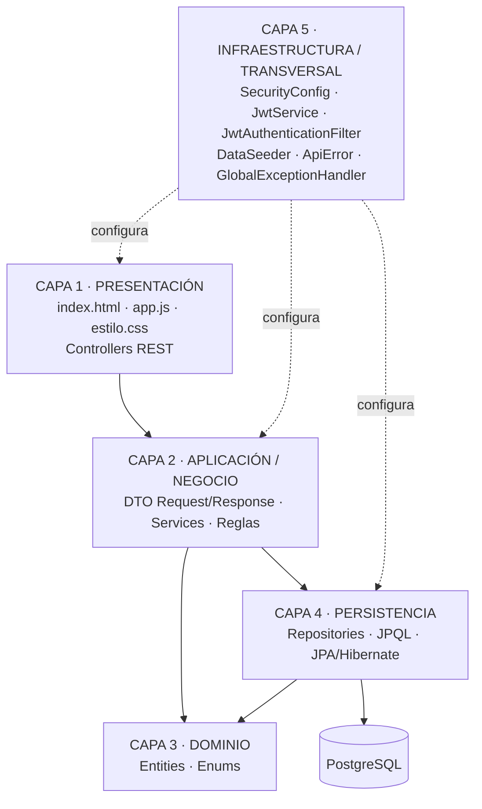

# Arquitectura N Capas de SINDACO

El sistema está organizado con **arquitectura en N capas** y, dentro de cada capa, **por módulos de negocio** (matrícula, agenda, académico, mantenimiento y seguridad). Esto combina orden por responsabilidad técnica con orden por dominio: cada caso de uso se implementa una sola vez y atraviesa las capas de arriba hacia abajo.

## 1. Vista general



## 2. Capas y responsabilidades

| # | Capa | Paquetes / archivos | Responsabilidad | NO debe hacer |
|---|---|---|---|---|
| 1 | **Presentación** | `resources/static/*` y `com.sindaco.<modulo>.controller` | Renderizar la UI, capturar formularios, recibir peticiones HTTP, validar formato (`@Valid`), devolver DTO | Contener reglas de negocio ni acceder a repositorios |
| 2 | **Aplicación / Negocio** | `com.sindaco.<modulo>.dto` y `.service` | Casos de uso, validaciones de negocio, transacciones (`@Transactional`), transformación de entidad a DTO | Conocer HTTP (request/response de Spring) ni devolver entidades |
| 3 | **Dominio** | `com.sindaco.<modulo>.entity` y `.enums` | Modelo de datos: entidades JPA y estados del negocio | Contener lógica de casos de uso ni depender de Spring MVC |
| 4 | **Persistencia** | `com.sindaco.<modulo>.repository` | Acceso a datos: Spring Data JPA, consultas derivadas y JPQL | Exponer entidades directamente a la capa 1 |
| 5 | **Infraestructura / Transversal** | `com.sindaco.config`, `com.sindaco.comun`, `com.sindaco.seguridad` | Seguridad JWT, CORS, arranque y datos iniciales, manejo uniforme de errores | Implementar casos de uso de los módulos |

> Nota: el módulo `seguridad` es transversal: `AuthService` pertenece a la capa 2, `Usuario` a la capa 3, `UsuarioRepository` a la capa 4 y `JwtService`/`SecurityConfig` a la capa 5.

## 3. Reglas de dependencia

1. Las flechas apuntan **siempre hacia abajo**: Presentación → Aplicación → (Dominio y Persistencia).
2. El **controlador es delgado**: solo delega en el servicio.
3. Las **entidades nunca salen** de la capa de negocio: se transforman en `...Request` (entrada) y `...Response` (salida).
4. Las **consultas JPQL viven en el repositorio** de su entidad.
5. Un **módulo no usa repositorios de otro módulo**: invoca su servicio (ej. `ClaseServiceImpl` llama a `AlumnoService.buscarPorId`).
6. Los **errores** se lanzan con `RecursoNoEncontradoException` (404), `ReglaNegocioException` (400) o `ConflictoException` (409) y `GlobalExceptionHandler` los convierte a `ApiError`.
7. Las **transacciones** se declaran en el servicio, nunca en el controlador.

## 4. Flujo de una petición (ejemplo: programar clase)

```
POST /api/clases  (frontend app.js, token JWT)
   │
   ▼ ClaseController.crear(@Valid ClaseRequest)        [Capa 1]
   │
   ▼ ClaseServiceImpl.crear(...)  @Transactional       [Capa 2]
   │   · valida horaFin > horaInicio
   │   · AlumnoService.buscarPorId(...)                 [otro módulo, capa 2]
   │   · InstructorService.buscarPorId(...)
   │   · VehiculoService.buscarPorId(...)
   │   · ClaseRepository.existeSolapamiento(...)        [Capa 4]
   │   · construye Clase (entidad)                      [Capa 3]
   │
   ▼ ClaseRepository.save(clase)                       [Capa 4 → PostgreSQL]
   │
   └─ devuelve ClaseResponse → JSON al frontend
```

## 5. Mapa de módulos

| Módulo | Casos de uso | Entidades | Capa 1 (controllers) |
|---|---|---|---|
| `seguridad` | Login, roles y usuarios | Usuario, Rol | AuthController, UsuarioController |
| `matricula` | CU01, CU02, CU08 | Alumno, Matricula, Pago, Paquete | Alumno, Matricula, Pago, Paquete |
| `agenda` | CU03, CU04 | Clase, Instructor, Vehiculo | Clase, Instructor, Vehiculo |
| `academico` | CU05, CU06, CU09, CU10 | AsistenciaEvaluacion, Reprogramacion | Asistencia, Reprogramacion, Reporte, Historial |
| `mantenimiento` | CU07 | Mantenimiento | Mantenimiento |

## 6. Convenciones

- Paquetes: `com.sindaco.<modulo>.<capa>` (`controller`, `dto`, `service`, `repository`, `entity`, `enums`).
- DTOs: `record` con Bean Validation en los `Request`.
- Servicios: interfaz `XService` + implementación `XServiceImpl`.
- Rutas REST: plurales en minúscula (`/api/matriculas`).
- Un caso de uso = un método público del servicio con nombre en español (`registrarMatricula`, `crear`, `listar`).
- Mensajes de error y etiquetas de UI en español.
- Codificación de fuentes: UTF-8 (configurada en `pom.xml`).
